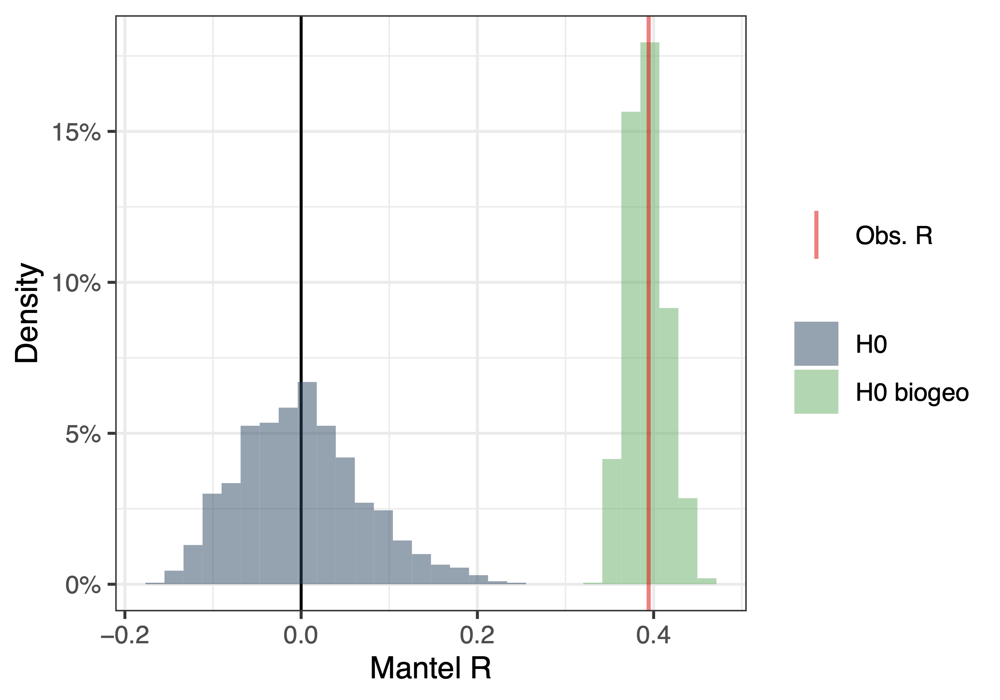
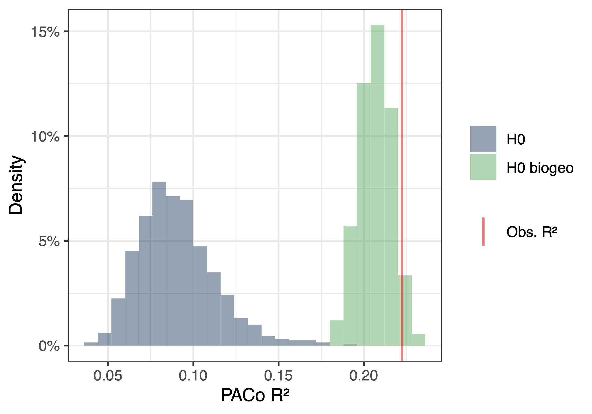
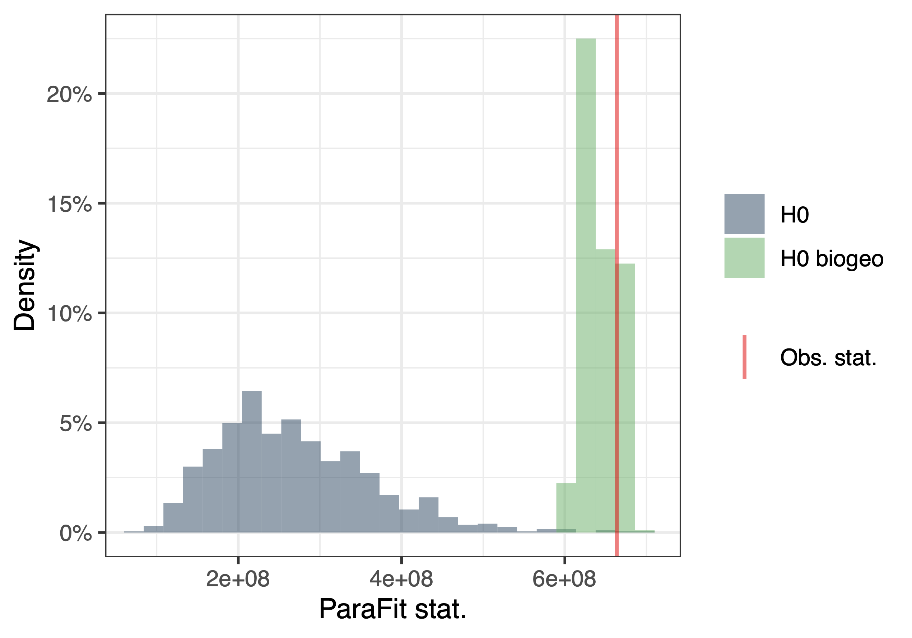

**Guidelines for assessing the influence of biogeography on (co)phylogenetic signals in species interactions:**
====

<br>


This tutorial presents functions from the EVOLI R-package to evaluate the effect of biogeography on (co)phylogenetic patterns of species interactions (e.g. cophylogenetic signal, phylogenetic signal, phylosymbiosis...). 
To do so, it performs biogeography-based permutations. 


<br>

**Citation:** Ibos Y, Sagnard A, Perez-Lamarque B (2026), Assessing the influence of biogeography on (co)phylogenetic signals in species interactions, in prep.


**Contact:** benoit.perez-lamarque@utoulouse.fr

<br> 


# Install the EVOLI package


```r
library(pak)

pak::pak("BPerezLamarque/EVOLI", dependencies = TRUE)

```

# Load the data: 


```r

library(EVOLI)

set.seed(3)

data("cophylogenetic_system") # Load the data

tree_A <- cophylogenetic_system$tree_A # Phylogenetic tree of clade A
tree_B <- cophylogenetic_system$tree_B # Phylogenetic tree of clade B
network <- cophylogenetic_system$network # Present-day interaction network between species of clade A (on columns) and species of clade B (on rows)
table_biogeo_host <- cophylogenetic_system$table_biogeo_host # A two-column table indicating the biogeographic repartition of each species of clade A


nperm <- 1000 # At least 10000 permutations should be used (1000 is only for providing a fast example)

```

# Run Mantel tests: 

```r

# Run Mantel test under "H0" (random shuffling of the species labels)
mantel_result <- phylosignal_network(network, tree_A, method="Jaccard_binary", nperm = nperm, permutation ="shuffle")

# Run Mantel test under "H0 biogeo" (biogeography-based shuffling of the species labels)
mantel_result_biogeo <- phylosignal_network(network, tree_A, method="Jaccard_binary", nperm = nperm, permutation ="biogeo", table_biogeo = table_biogeo_host)

# Compare the results obtained under the two null models 
mantel_result[c("mantel_cor_A","p_upper_A")] # Test statistic and p-value under "H0"
mantel_result_biogeo[c("mantel_cor_A","p_upper_A")] # Test statistic and p-value under "H0 biogeo"
compare_null_models(mantel_result, mantel_result_biogeo, method = "mantel") # Standardized effect sizes and f fraction

# Plot the distributions under the two null models
plot_null_models_comparison(mantel_result, mantel_result_biogeo, "mantel")


```

The Mantel correlation for phylogenetic signal in species interactions in clade A is `R=0.39` and the associated p-values are `p=0.001` under "H0" and `p=0.443` under "H0 biogeo". 

The output of  `compare_null_models` is then:


| Null model | mean | sd | SES | f fraction | 
| --- | --- | --- | --- | --- |
| Random permutations (H0) | -0.0044 | 0.0704 | 5.6639 |   |
| Biogeographic-based permutations (H0 biogeo) | 0.3919 | 0.023 | 0.1073 |  0.9938 |


which indicates the mean values of the null distributions of the test statistic under "H0" and "H0 biogeo", their standard deviations (sd), their standardized effect sizes (SES), and the f fraction defined as the fraction of original deviation that could be attributed to biogeography when comparing the null distributions "H0" and "H0 biogeo".


<p align="center">
    
</p>

<p align="center">
    <b>Null distributions of the Mantel correlation (R) expected under "H0" (random permutations; in blue) or under "H0 biogeo" (biogeographic-based permutations; in green) compared with the original Mantel correlation (in red).</b>
</p>


# Run PACo: 

```r

# Run PACo under "H0" (random shuffling of the species labels)
PACo_result <- PACo_test(tree_A, tree_B, network, nperm = nperm, nullmodel = "shuffle")

# Run PACo under "H0 biogeo" (biogeography-based shuffling of the species labels)
PACo_result_biogeo <- PACo_test(tree_A, tree_B, network, nperm = nperm, nullmodel = "biogeo", table_biogeo = table_biogeo_host)

# Compare the results obtained under the two null models 
PACo_result[c("R2_obs","p")] # Test statistic and p-value under "H0"
PACo_result_biogeo[c("R2_obs","p")] # Test statistic and p-value under "H0 biogeo"
compare_null_models(PACo_result, PACo_result_biogeo, method = "paco") # Standardized effect sizes and f fraction

# Plot the distributions under the two null models
plot_null_models_comparison(PACo_result, PACo_result_biogeo, "paco")


```


The PACo statistic for cophylogenetic signal is `R^2=0.22` and the associated p-values are `p=0.001` under "H0" and `p=0.056` under "H0 biogeo". 

The output of  `compare_null_models` is then:


| Null model | mean | sd | SES | f fraction | 
| --- | --- | --- | --- | --- |
| Random permutations (H0) | 0.0888 | 0.0212 | 6.2955 |   |
| Biogeographic-based permutations (H0 biogeo) | 0.2065 | 0.0097 | 1.6292 |  0.882 |


<p align="center">
    
</p>

<p align="center">
    <b>Null distributions of the PACo statistic (R^2) expected under "H0" (random permutations; in blue) or under "H0 biogeo" (biogeographic-based permutations; in green) compared with the original statistic (in red).</b>
</p>


# Run ParaFit: 

```r

# Run ParaFit under "H0" (random shuffling of the species labels)
parafit_result <- parafit_test(tree_A, tree_B, network, nperm = nperm, nullmodel = "shuffle")

# Run ParaFit under "H0 biogeo" (biogeography-based shuffling of the species labels)
parafit_result_biogeo <- parafit_test(tree_A, tree_B, network, nperm = nperm, nullmodel = "biogeo", table_biogeo = table_biogeo_host)

# Compare the results obtained under the two null models 
parafit_result[c("ParaFitGlobal","p")] # Test statistic and p-value under "H0"
parafit_result_biogeo[c("ParaFitGlobal","p")] # Test statistic and p-value under "H0 biogeo"
compare_null_models(parafit_result, parafit_result_biogeo, method = "parafit") # Standardized effect sizes and f fraction

# Plot the distributions under the two null models
plot_null_models_comparison(parafit_result, parafit_result_biogeo, "parafit")


```

The ParaFit statistic for cophylogenetic signal is `ParaFitGlobal=663579728` and the associated p-values are `p=0.002` under "H0" and `p=0.21` under "H0 biogeo". 

The output of  `compare_null_models` is then:


| Null model | mean | sd | SES | f fraction | 
| --- | --- | --- | --- | --- |
| Random permutations (H0) | 268576964 | 89957719 | 4.391 |   |
| Biogeographic-based permutations (H0 biogeo) | 642349917 | 20173864 | 1.0523 |  0.9463 |


<p align="center">
    
</p>

<p align="center">
    <b>Null distributions of the ParaFit statistic expected under "H0" (random permutations; in blue) or under "H0 biogeo" (biogeographic-based permutations; in green) compared with the original statistic (in red).</b>
</p>

