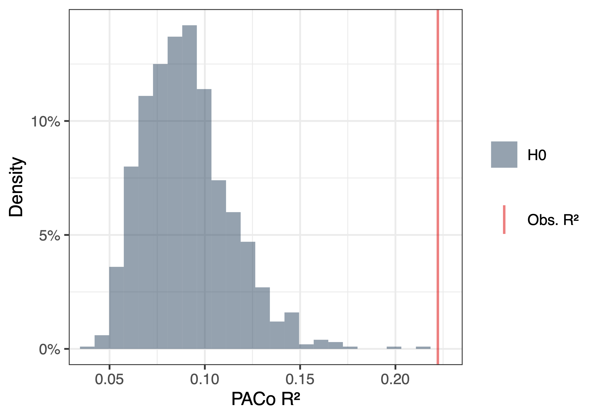
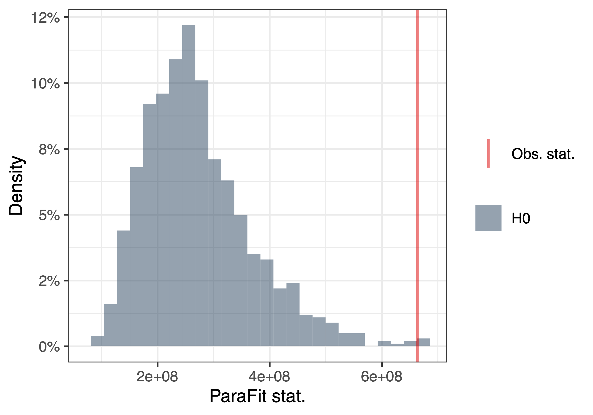

**Guidelines to measure cophylogenetic signal and phylogenetic congruence in a bipartite interaction network:**
====

<br>

This folder contains the scripts for reproducing the analysis of *Distinguishing cophylogenetic signal from phylogenetic congruence clarifies the interplay between evolutionary history and species interactions* by Benoît Perez-Lamarque and Hélène Morlon (citation: <a href="https://doi.org/10.1093/sysbio/syae013">Perez-Lamarque & Morlon, 2024; Systematic Biology</a>).

<br>

These scripts can be used to mesure two different patterns: 
1) **Cophylogenetic signal** ("Do closely related hosts interact with closely related symbionts?")
2) **Phylogenetic congruence** ("Do host and symbiont phylogenies mirror one another?").

<br>

# Contents:

It contains 3 files:
- "script_cophylogenetic_signal.R": the script to reproduce the simulations, run global-fit approaches for measuring cophylogenetic signal, and plot the figures
- "functions_parafit_paco.R": ParaFit and PACo functions that implement the  "null model 2" that randomly shuffles species labels in one clade (see https://doi.org/10.1111/mec.16681 for more details)
- "script_run_eMPRess.sh": the script for automatically running eMPRess with the command line on our simulations for measuring phylogenetic congruence. 


Contact: benoit.perez-lamarque@utoulouse.fr

<br> 

# Guidelines for measuring cophylogenetic signals in species interaction network:

Functions for measuring cophylogenetic signals are available from the <a href="https://github.com/BPerezLamarque/EVOLI">EVOLI R-package</a> (Ibos et al., in prep).

## Load the data
```r
library(EVOLI)


data("cophylogenetic_system") # Load the data

tree_A <- cophylogenetic_system$tree_A # Phylogenetic tree of clade A
tree_B <- cophylogenetic_system$tree_B # Phylogenetic tree of clade B
network <- cophylogenetic_system$network # Present-day interaction network between species of clade A (on columns) and species of clade B (on rows)
table_biogeo_host <- cophylogenetic_system$table_biogeo_host # A two-column table indicating the biogeographic repartition of each species of clade A


nperm <- 1000 # At least 10000 permutations should be used (1000 is only for providing a fast example)

```

## Run PACo
```r

# Run PACo under "H0" (random shuffling of the species labels)
PACo_result <- PACo_test(tree_A, tree_B, network, nperm = nperm, nullmodel = "shuffle")

# Print the test statistic and p-value under "H0"
PACo_result[c("R2_obs","p")]

# Plot the null distribution under "H0"
plot_null_model(PACo_result, "paco")

```


The PACo statistic for cophylogenetic signal is `R^2=0.22` and the associated p-value is `p=0.001` under "H0". 


<p align="center">
    
</p>

<p align="center">
    <b>Null distribution of the PACo statistic (R^2) expected under "H0" (random permutations; in blue) compared with the original statistic (in red).</b>
</p>


## Run ParaFit
```r
# Run ParaFit under "H0" (random shuffling of the species labels)
parafit_result <- parafit_test(tree_A, tree_B, network, nperm = nperm, nullmodel = "shuffle")

# Print the test statistic and p-value under "H0"
parafit_result[c("ParaFitGlobal","p")]

# Plot the null distribution under "H0"
plot_null_model(parafit_result, "parafit")

```


The ParaFit statistic for cophylogenetic signal is `ParaFitGlobal=663579728` and the associated p-value is `p=0.004` under "H0". 


<p align="center">
    
</p>

<p align="center">
    <b>Null distribution of the ParaFit statistic expected under "H0" (random permutations; in blue) compared with the original statistic (in red).</b>
</p>


<br> 


## Assessing the effect of biogeography on the cophylogenetic signal in species interactions

This can be using biogeography-based permutations that only shuffle species that co-occur on the same area. <a href="https://github.com/BPerezLamarque/Scripts/tree/master/Biogeography_interactions">See the complete tutorial here.</a> (citation: Ibos et al., 2026, in prep.) 


<br> <br>